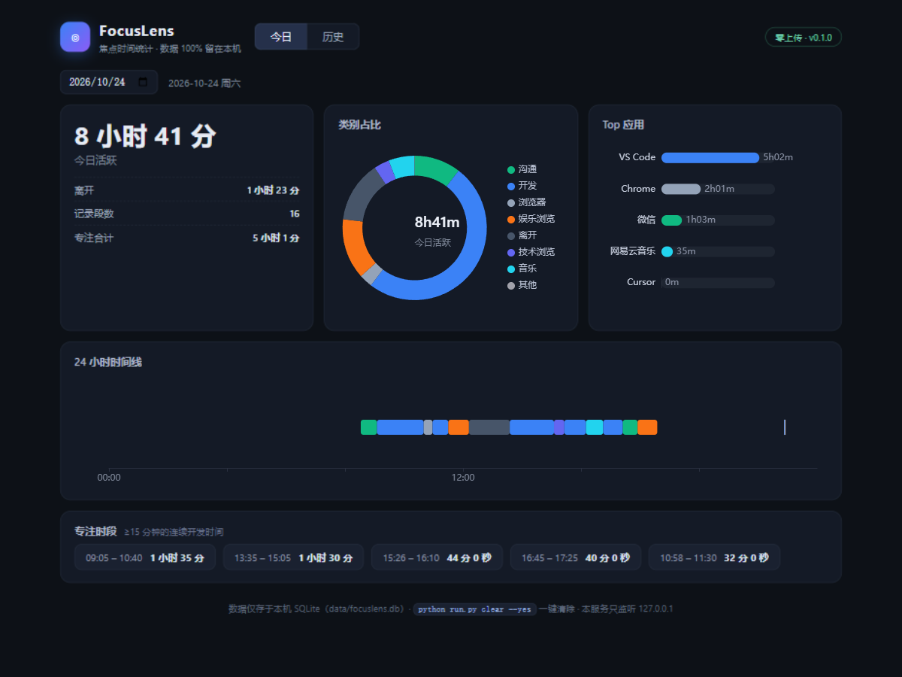

# FocusLens · 焦点时间统计器

> Windows 上的「屏幕使用时间」：自动记录你在每个应用上花的时间，**100% 本地**，零网络请求。

**中文** | [English](README.en.md)



iPhone 有屏幕使用时间，Windows 一直没有对等物。RescueTime 是云服务 + 订阅制，现有开源方案对中文应用/网站的识别又偏弱——FocusLens 想补上这个空缺：

- **隐私优先**：纯本地运行，零网络请求，数据可一键清除——开源让这句话可被验证；
- **开箱即用的中文规则库**：微信 / QQ / 钉钉 / 网易云音乐 / B 站 / 知乎 / 京东…装完即正确分类，规则库接受社区 PR；
- **可读的日报**：24 小时时间线、类别占比、Top 应用、专注时段统计；
- **极轻**：采集端纯 Python 标准库（ctypes 调 Win32 API），无第三方依赖。

## 隐私声明（请先读这一段）

- **零网络请求**：采集器不引用任何网络库；Web 报表的 Vue/ECharts 已随仓库本地化，打开页面不会请求任何 CDN。欢迎搜代码验证。
- 只读取**当前前台窗口**的进程名与标题（普通桌面 API 都能调用的信息），不做键盘记录、不截屏、不上传。
- 三档隐私级别（`config.json` 的 `privacy`）：
  | 级别 | 行为 |
  |---|---|
  | `default`（默认） | 只存进程名 + 类别，**标题不落盘** |
  | `hash` | 只存标题哈希（可区分同类文档、不可回读） |
  | `full` | 存标题（仅本地） |
- 数据是单个 SQLite 文件（`data/focuslens.db`），`python run.py clear --yes` 一键清除并回收磁盘空间。
- Web 报表只监听 `127.0.0.1`，不对局域网开放。
- ⚠️ 这是「自己的时间统计器」，请勿安装在他人电脑上。

## 快速开始

要求：Windows 10/11，Python 3.9+（仅 Web 报表需要 `fastapi/uvicorn`，**采集端零第三方依赖**）。

```bash
git clone https://github.com/lixiaonatongxue/FocusLens.git
cd FocusLens
python -m venv .venv
.venv/Scripts/python.exe -m pip install -r requirements.txt

# 1) 开始采集（常驻运行，Ctrl+C 停止；先试 60 秒可加 --duration 60）
.venv/Scripts/python.exe run.py collect

# 2) 查看报表
.venv/Scripts/python.exe run.py report today     # 命令行版
.venv/Scripts/python.exe run.py serve            # 网页版 → http://127.0.0.1:8810

# 3)（推荐）一次配置，开机自动采集，无需再手动运行
.venv/Scripts/python.exe run.py autostart

# 还没有数据、想先看看效果？
.venv/Scripts/python.exe run.py demo             # 写入一天虚构的"开发者的一天"
```

其他命令：

| 命令 | 作用 |
|---|---|
| `run.py autostart` | 开机自动采集（安装启动项 + 立即后台运行），`--remove` 停止并卸载 |
| `run.py report week` | 近 7 天文本报表 |
| `run.py report today --date 2026-10-24` | 查看指定日期 |
| `run.py classify --exe WeChat.exe --title 微信` | 调试规则匹配（贡献规则时必用） |
| `run.py clear --yes` | 清空全部本地数据 |

## 工作原理

```
前台窗口事件(SetWinEventHook) ─┐
                              ├─→ 采集状态机 ─→ 分类引擎 ─→ SQLite
每秒轮询兜底 + 空闲检测 ───────┘        （进程名规则 + 浏览器标题细分）
```

- **采集**：事件驱动监听窗口切换 + 每秒轮询兜底；标题变化（如浏览器换标签页）也会切分时段；同一窗口停留超 60 秒周期性落盘，报表近实时可见；
- **空闲识别**：键鼠无输入超过 5 分钟（可配）记为「离开」，其中前 5 分钟宽限记给当前应用；
- **睡眠保护**：采样出现大间隙（休眠/挂起）时自动封段，不把睡眠时间记进任何应用；
- **浏览器细分**：Chrome/Edge 等的窗口标题含页面名（"xxx - 哔哩哔哩"），用 `rules/sites.json` 细分到网站级。

## 规则库共建（欢迎 PR，门槛极低）

规则就是一行 JSON：

```json
{"match": {"exe": ["Weixin.exe"]}, "category": "im", "name": "微信"}
```

加完用 `python run.py classify --exe Weixin.exe` 验证即可提交。详见 [CONTRIBUTING.md](CONTRIBUTING.md)。

## 路线图

- [x] v0.1 采集 / 分类 / SQLite / CLI 报表 / 本地 Web 报表 / 开机自动采集
- [ ] v0.2 日报卡片导出图片、摸鱼预警提醒
- [ ] v0.3 托盘常驻、UWP 应用深度识别（`GetApplicationUserModelId`）、数据导出 CSV

## 开发

```bash
.venv/Scripts/python.exe -m unittest discover -s tests -t .
```

架构与设计取舍见 [docs/design-plan.md](docs/design-plan.md)。

## License

[MIT](LICENSE)
